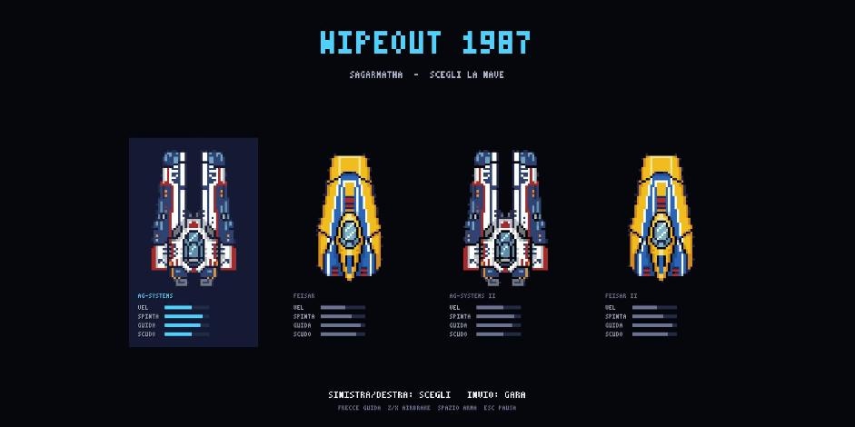
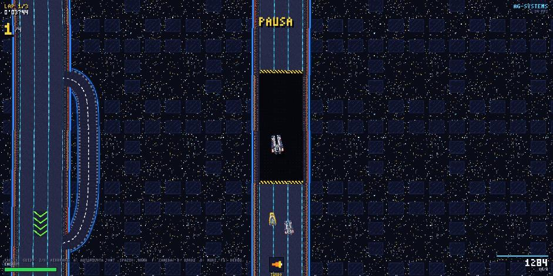

# WIPEOUT 1987

A top-down, 2D, pixel-art tribute to **WipEout**.

## [▶ PLAY HERE](https://lucavix.github.io/wipeout1987/)

Runs in the browser, nothing to install. Keyboard required.

I have been playing video games for forty years, and no game has ever hit me the way WipEout did:
the speed, the anti-gravity handling, the neon tracks, the music, the whole Designers Republic look.
This little project is my way of saying thank you to the people who made it, and of saying out loud
what so many of us hope: **that the series comes back**. We are still here, still waiting for the next one.

This is a fan project. It is not affiliated with, endorsed by, or connected to Sony Interactive
Entertainment, Psygnosis, Studio Liverpool or anyone who owns the WipEout name. WipEout is a
trademark of its respective owners. Everything here was written from scratch; the artwork is
original pixel art inspired by the games.



## What it is

- A single circuit, **Sagarmatha**, traced from the original layout: a long left straight, a hairpin,
  a jump on the right straight, a wide loop at the top and a pit lane that recharges your energy.
- Vector track geometry with chunky 8-bit textures: five parallel strips (two neon kerbs, three lanes),
  one PNG texture per strip, every world pixel mapped to exactly one texel.
- Anti-gravity handling: thrust, brake, steering that tightens as you slow down, left/right airbrakes
  that make the ship drift. Scraping a wall at a shallow angle throws sparks and pins you to it until
  you steer away; hitting it hard bounces you off and costs energy.
- Speed pads, a jump (too slow and you fall), and a pit lane with a speed limit.
- Weapon pads hand out turbo, homing missile, rockets, mines and shield. Energy runs out, you blow up.
- Three AI opponents with different skill levels, lap counting with sector gates, lap and best-lap
  times, live position, a results screen.
- Camera that pulls back as you speed up. Ribbon trails behind the engines. Ships bank and pitch
  with the controls.
- Everything runs in an HTML5 canvas, no WebGL, no dependencies at runtime. No sound (yet).



## Controls

| Key | Action |
|---|---|
| Arrow up / down | Thrust / brake |
| Arrow left / right | Steer |
| Z / X | Left / right airbrake |
| Space | Use item |
| Esc | Pause |
| Enter | Start the race / back to ship select |
| A | Autopilot (handy to watch the track) |
| F / O | Free camera / whole track |
| B / D | Show strip outlines / walls |
| F1 | Tuning panel: physics and camera parameters, live |

## Running it

```
npm install
npm run dev
```

Then open http://127.0.0.1:5187/. `npm run build` produces a static site in `dist/`; every push to
`main` deploys it to GitHub Pages through `.github/workflows/pages.yml`.

## How it is built

- Vite + TypeScript, Canvas 2D with `imageSmoothingEnabled = false`, fixed 60 Hz update loop.
- `src/track/` builds the track from a hand-traced centreline (Catmull-Rom spline, curvature
  limiting, strip profile, walls, jump and pad tiles) and rasterises it once at start-up into a single
  world-aligned bitmap by forward splatting; each frame only the visible rectangle is blitted.
- `src/game/physics.ts` is the handling model, `src/game/weapons.ts` the items, `src/game/ai.ts` the
  opponent drivers, `src/game/race.ts` laps and ranking.
- Ships are pixel art stored as character grids in `src/gfx/ships.ts`; `tools/extract_sprite.py`
  turns an image into one of those grids. Two ships for now (AG Systems and FEISAR); the others will
  come from a proper pixel artist.
- Track textures are PNGs in `public/textures/`, with procedural fallbacks in `src/gfx/tilegen.ts`
  (`npm run textures:generate` exports them).

Built with the help of Claude Code.

## License

MIT for the code. The WipEout name, team names and track names belong to their owners.
